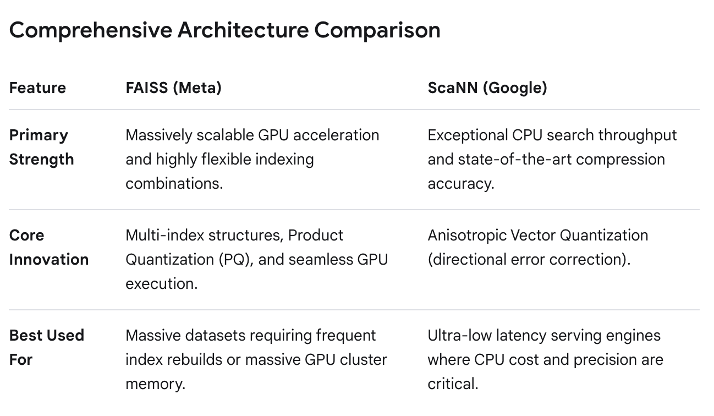

# Inside TikTok's Architecture

> A technical overview of the real-time data pipelines, distributed memory systems, vector retrieval, and machine-learning ranking used by large-scale recommendation platforms such as TikTok.

## Table of Contents

1. [High-Level AI Factory Architecture](#1-high-level-ai-factory-architecture)
2. [Real-Time Log Pipeline](#2-real-time-log-pipeline)
3. [Monolith and Cuckoo Hashing](#3-monolith-and-cuckoo-hashing)
4. [Candidate Retrieval with Two-Tower Networks](#4-candidate-retrieval-with-two-tower-networks)
5. [Fast Approximate Vector Search](#5-fast-approximate-vector-search)
6. [Fine Ranking with MMoE](#6-fine-ranking-with-mmoe)
7. [Lifecycle of a User Profile Vector](#7-lifecycle-of-a-user-profile-vector)
8. [End-to-End Architecture Summary](#8-end-to-end-architecture-summary)
9. [Expanded Notes from the Original Draft](#9-expanded-notes-from-the-original-draft)
   - [Video Processing and Delivery](#91-video-processing-and-delivery)
   - [Streaming Events and User-State Updates](#92-streaming-events-and-user-state-updates)
   - [Sparse Parameters and Cuckoo Hashing](#93-sparse-parameters-and-cuckoo-hashing)
   - [Two-Tower Retrieval Details](#94-two-tower-retrieval-details)
   - [Multi-Objective Ranking Details](#95-multi-objective-ranking-details)
   - [Product Quantization Worked Example](#96-product-quantization-worked-example)
   - [User-Profile Updates and Abrupt Interest Shifts](#97-user-profile-updates-and-abrupt-interest-shifts)
   - [Further Reading and Original References](#98-further-reading-and-original-references)

---

## 1. High-Level AI Factory Architecture

Unlike traditional social networks that depend heavily on a fixed social graph, large-scale recommendation systems convert each interaction into a signal that can update the next feed request.

```text
+-----------------------+       +-------------------------+       +----------------------+
| Video delivery        |       | Real-time behavior      |       | Recommendation       |
| - Transcoding         |       | - Dwell time            |       | - Candidate retrieval|
| - Feature extraction  |       | - Replays               |       | - Fine ranking       |
| - CDN distribution    |       | - Swipes and hesitation |       | - Feed composition   |
+-----------------------+       +-------------------------+       +----------------------+
           |                            |                              |
           +----------------------------+------------------------------+
                                        |
                                        v
                           Personalized For You feed
```

### Core components

| Component                 | Purpose                                                                                                     |
| ------------------------- | ----------------------------------------------------------------------------------------------------------- |
| High-speed video pipeline | Transcodes uploaded media, extracts features, creates content embeddings, and caches assets close to users. |
| Streaming data engine     | Collects interaction events and updates user or model state with low latency.                               |
| Recommendation engine     | Retrieves a small candidate set and applies multi-objective ranking before returning the feed.              |

### Two-stage recommendation flow

```text
Millions of videos
        |
        v
Deep retrieval / two-tower matching
        |
        v
Hundreds of candidates
        |
        v
Multi-objective fine ranking
        |
        v
Final ordered feed
```

---

## 2. Real-Time Log Pipeline

A decoupled streaming pipeline allows the feed to respond to behavior without blocking the user-facing application during traffic spikes.

```text
TikTok app
    |
    | HTTPS interaction event
    v
+--------------------+
| Flume / Scribe     |  Collect and format edge logs
+--------------------+
    |
    v
+--------------------+
| Apache Kafka       |  Buffer and distribute event streams
+--------------------+
    |
    v
+--------------------+
| Apache Flink       |  Join and process live events
+--------------------+
    |
    v
+--------------------+
| Parameter server   |  Update user preference state
+--------------------+
    |
    v
Personalized next feed
```

### Event-flow stages

| Stage             | Responsibility                                                                                                  |
| ----------------- | --------------------------------------------------------------------------------------------------------------- |
| Collection        | Edge agents collect, structure, and forward interaction logs.                                                   |
| Transport         | Kafka distributes high-volume events between producers and consumers while absorbing spikes.                    |
| Stream processing | Flink joins interaction events with content context and continuously computes state updates.                    |
| Serving           | The recommendation system reads updated state when producing the next request's candidates and ranking results. |

### Commonly collected signals

- Explicit interactions, such as likes, comments, shares, and follows.
- Implicit interactions, such as watch duration, completion, replay, swipe speed, and hesitation.
- Context, such as device, session state, location when permitted, language, and active viewing sequence.

---

## 3. Monolith and Cuckoo Hashing

Recommendation systems maintain very large sparse embedding tables. Standard hash tables can place different keys into the same slot, while fixed hashing strategies may make collisions expensive to resolve.

**Monolith**, ByteDance's recommendation architecture, uses a parameter-serving model designed for rapidly changing sparse embeddings.

### Cuckoo hashing

Cuckoo hashing stores each key in one of two possible locations selected by separate hash functions.

```text
Key A chooses T0
      |
      v
T0 slot is occupied by B
      |
      v
Move B to its alternative location in T1
      |
      v
Move the displaced key to its alternative location
      |
      v
Continue until an empty slot is found
```

### Important properties

- Each key has two potential locations.
- Lookup generally compares only the two candidate locations.
- Insertion evicts and relocates an occupant when both locations are full.
- Long eviction chains require rebuilding or resizing the table when load becomes too high.
- Expiration and filtering reduce stale entries and active memory usage.

### Memory optimization techniques

| Technique                | Purpose                                                                             |
| ------------------------ | ----------------------------------------------------------------------------------- |
| Count-Min Sketch         | Estimates item frequency and helps identify cold or low-value entries.              |
| Time-to-live             | Automatically expires stale preference fields.                                      |
| Sharding                 | Splits the parameter space across independent server processes or machines.         |
| Sparse embedding storage | Stores parameters for observed IDs instead of maintaining dense parameter matrices. |

---

## 4. Candidate Retrieval with Two-Tower Networks

Scanning all videos and running a deep ranking model for every candidate would violate the latency budget. Candidate retrieval first narrows the corpus with two independent embedding towers.

```text
User ID + context                     Video ID + metadata
       |                                      |
       v                                      v
+---------------+                      +---------------+
| User tower    |                      | Item tower    |
+---------------+                      +---------------+
       |                                      |
       v                                      v
User embedding u                     Video embedding v
       |                                      |
       +-------------- dot product ------------+
                       |
                       v
                Similarity score
```

### User tower

The user tower processes:

- Current session activity.
- Recent interaction sequence.
- User demographics and language, when permitted and available.
- Device or environmental context.

It produces a dense vector representing the user's current interest state.

### Item tower

The item tower processes content features such as:

- Visual features extracted by computer vision models.
- Speech or captions processed with language models.
- Audio features and music metadata.
- Creator, topic, and engagement features.

It produces a dense vector representing each candidate video.

### Decoupled inference

The item tower can run offline when a video is published or updated. The resulting vectors can be placed in an ANN index. The live request only:

1. Computes the user vector with the user tower.
2. Searches the precomputed item index.
3. Returns a candidate set, typically a few hundred videos.
4. Sends those candidates to the fine-ranking model.

This separation keeps expensive model execution off the retrieval request path.

---

## 5. Fast Approximate Vector Search

Candidate retrieval uses approximate nearest-neighbor search rather than exact comparison against every video.

To understand how FAISS (Facebook AI Similarity Search) and ScaNN (Scalable Nearest Neighbors by Google) work, it helps to look at the exact computational problem they solve.



### FAISS inverted-file indexing

FAISS can cluster vectors and build an inverted-file index:

1. Group vectors around learned centroids using clustering.
2. Assign each content vector to a cluster.
3. Search the clusters closest to the user vector.
4. Compare only vectors belonging to those clusters.

This trades a small amount of retrieval recall for substantially lower query cost.

### ScaNN anisotropic quantization

ScaNN improves quantized-vector similarity by reducing errors in directions that matter more for nearest-neighbor ranking. It combines:

- Learned partitioning.
- Anisotropic vector quantization.
- Efficient scoring for candidate retrieval.

### Product Quantization

Product Quantization compresses vectors by splitting them into smaller sub-vectors and replacing each segment with a codebook index.

```text
512-dimensional float vector
            |
            v
Split into 64 sub-vectors of 8 dimensions
            |
            v
Replace each segment with its nearest codebook entry
            |
            v
[42, 119, 7, ..., 211]  (64 bytes)
```

### Search process

1. Split the live query vector into the same number of segments as the stored vectors.
2. Compare each segment against its corresponding codebook.
3. Store the resulting distances in a lookup table.
4. Score a compressed candidate by summing its codebook lookups.
5. Avoid decompressing full vectors during the search.

This converts high-cost floating-point comparisons into compact storage and table lookups.

### Comparison

| Method               | Best-known role                     | Main trade-off                                              |
| -------------------- | ----------------------------------- | ----------------------------------------------------------- |
| Exact search         | Highest possible recall             | Too expensive at global scale.                              |
| FAISS IVF            | Fast coarse cluster filtering       | Candidate recall depends on how many clusters are searched. |
| ScaNN                | Accurate approximate retrieval      | Requires more complex index configuration and training.     |
| Product Quantization | Memory-efficient compressed vectors | Approximation can reduce retrieval precision.               |

---

## 6. Fine Ranking with MMoE

Fine ranking evaluates a few hundred candidates and models interactions between features. A Multi-Gate Mixture-of-Experts model can learn shared patterns while allowing separate tasks to emphasize different experts.

```text
                    Candidate features
                            |
              +-------------+-------------+
              |             |             |
              v             v             v
          Expert 1      Expert 2  ...  Expert N
              |             |             |
              +----- shared representations ----+
                            |
          +-----------------+-----------------+
          |                 |                 |
          v                 v                 v
      Like gate        Watch gate         Share gate
          |                 |                 |
          v                 v                 v
 P(Like) | E(Watch time) | P(Share)
```

### MMoE components

| Component           | Purpose                                                                          |
| ------------------- | -------------------------------------------------------------------------------- |
| Experts             | Specialized neural sub-networks learn patterns from candidate and user features. |
| Task-specific gates | Softmax gates choose how much each task should use each expert.                  |
| Task towers         | Convert expert representations into predictions for each objective.              |
| Blending function   | Converts task predictions into one final score and feed order.                   |

### Example blended score

$$
	ext{Final Score} = w_1 P(Like) + w_2 P(Share) + w_3 E(WatchDuration) - w_4 P(	ext{Repetitive})
$$

Weights are adjusted to support platform goals such as:

- Longer watch duration.
- More meaningful social interactions.
- Creator diversity.
- Reduced repetitive recommendations.
- Content safety and policy constraints.

---

## 7. Lifecycle of a User Profile Vector

A user profile is not a single static embedding. It commonly combines stable identity, long-term interests, and short-term intent.

| Layer                 | Typical time scale | Purpose                                                 |
| --------------------- | ------------------ | ------------------------------------------------------- |
| Static profile        | Months to years    | Language, device, demographics, and account attributes. |
| Long-term preferences | Weeks to months    | Stable topics and recurring interests.                  |
| Real-time intent      | Seconds to minutes | Recent viewing sequence and immediate context.          |

### Real-time update flow

```text
Recent user actions
        |
        v
+-----------------------+
| Short-term attention  |  Fast updates
+-----------------------+
        |
        +--------------------+
                             |
Recent actions             Stable preferences
        |                             |
        +-------------+---------------+
                      |
                      v
             Updated user vector
                      |
                      v
             Next candidate search
```

### Preventing rapid profile whiplash

A one-off interaction should not erase the user's stable interests. A common design uses two update gates:

- A **short-term gate** reacts quickly to a recent interaction or viewing sequence.
- A **long-term gate** changes slowly unless patterns are repeated over time.

For example, a short cat-video session may temporarily add cat videos to the next candidate set without changing the user's long-term interests.

### State synchronization

```text
User action
    |
    v
Interaction log
    |
    v
Stream processor
    |
    v
Feature and embedding state
    |
    v
Online parameter server
    |
    v
Retrieval requests read the latest state
```

---

## 8. End-to-End Architecture Summary

```text
+---------------------+       +----------------------+
| Upload and content  | ----> | Feature extraction   |
| transcoding         |       | and embedding        |
+---------------------+       +----------------------+
                                      |
                                      v
                              +---------------+
                              | Video index   |
                              +---------------+
                                      |
User action -> behavior logs -> stream processing -> profile state
                                                      |
                                                      v
                                           User embedding
                                                      |
                                                      v
                                           ANN candidate search
                                                      |
                                                      v
                                              MMoE ranking
                                                      |
                                                      v
                                             Ordered feed
```

## Design principles

1. Keep the hot serving path small and predictable.
2. Precompute expensive item embeddings.
3. Decouple ingestion, stream processing, serving, and training.
4. Retrieve candidates approximately, then rank them accurately.
5. Separate short-term intent from stable preferences.
6. Measure latency, recall, diversity, ranking quality, and system cost together.
7. Apply safety, privacy, policy, and abuse controls to data collection and ranking.

---

_This document describes a general large-scale recommendation architecture. TikTok's proprietary implementation details may differ._

---

## 9. Expanded Notes from the Original Draft

This appendix retains the additional explanations, examples, and reading links from the original notes, arranged in the order that data moves through a recommendation system. These are architecture concepts and publicly discussed patterns; they should not be read as confirmation that every named technology, numeric target, or implementation detail is used by TikTok.

### 9.1 Video Processing and Delivery

An uploaded video can pass through an asynchronous media pipeline before it becomes a recommendation candidate:

1. **Ingest and validate** the upload, metadata, and associated permissions.
2. **Transcode in parallel** into resolutions, codecs, and bitrates suitable for different devices and network conditions.
3. **Extract content features** from frames, audio, captions, and other metadata. Computer vision, speech recognition, language processing, and audio analysis can provide tags or model features.
4. **Create item representations** such as embeddings for later retrieval and ranking.
5. **Distribute media** through a content-delivery network (CDN), using caching strategies that place frequently requested assets near viewers.

The media-delivery path and recommendation path are related but distinct: the recommendation system selects content, while storage and CDN infrastructure deliver the selected media.

### 9.2 Streaming Events and User-State Updates

The original notes describe interactions such as viewing, swiping, pausing, replaying, liking, commenting, sharing, and following. Watch duration, completion, replay, and swipe timing are examples of implicit feedback; explicit actions such as likes and shares are additional signals. Collection and use of these signals must follow privacy, retention, and policy requirements.

An illustrative event path is:

```text
App interaction
      |
      v
Edge collection / event logging
      |
      v
Kafka topics or equivalent event transport
      |
      v
Flink or equivalent stream processing
      |
      +---- join event with content features
      |
      v
Update online user or feature state
      |
      v
Next recommendation request reads refreshed state
```

| Layer | Role in the conceptual pipeline |
|---|---|
| Edge collectors (for example, Flume or Scribe) | Collect and structure events near request-serving infrastructure, then forward them to downstream systems. |
| Event transport (for example, Kafka) | Partition, buffer, and distribute events so consumers can process them independently. Retention and delivery guarantees depend on configuration. |
| Stream processing (for example, Flink) | Process events continuously, enrich them with content context, and update derived features or state. |
| Online serving or parameter store | Make current user and model features available to retrieval and ranking requests. |

For example, a stream processor could join a viewing event with an item's precomputed category, audio, or visual features, then update short-term interest signals. Actual end-to-end delay varies with the system and is not guaranteed by the choice of these technologies alone.

### 9.3 Sparse Parameters and Cuckoo Hashing

Large recommendation models often use sparse features: only a small fraction of possible user, item, or context IDs are active for a given request. Embedding tables and parameter servers are common ways to represent and serve these learned values. A serving system may separate frequently updated sparse parameters from denser model computation and distribute the data across shards.

The original notes use Cuckoo hashing to explain predictable lookup behavior:

1. Two hash functions, `h0(x)` and `h1(x)`, give each key two possible locations in tables `T0` and `T1`.
2. Insertion checks one location. If occupied, it places the new key there and displaces the prior key.
3. The displaced key is tried at its alternate location, potentially displacing another key.
4. If the relocation chain exceeds a limit or cycles, the table may need a rebuild, resizing, or new hash functions.

```text
Insert A at h0(A)
        |
        +-- occupied by B --> move B to h1(B)
                                  |
                                  +-- occupied by C --> move C to h0(C)
                                                              |
                                                              +--> continue or rebuild
```

Lookup checks the key's candidate locations rather than following an unbounded collision chain. This gives constant-time lookup under the data structure's assumptions, while insertion and rebuild behavior still require careful load-factor and failure handling.

Other memory-management ideas mentioned in the original notes include:

- **Frequency estimation:** A Count-Min Sketch or similar compact structure can estimate how often IDs occur and help prioritize scarce memory. It is an approximate estimator, not a definitive record of each key.
- **Expiration:** Time-to-live or recency policies can evict stale or inactive state when the application semantics permit it.
- **Sharding:** Partitioning keys across machines increases capacity but introduces routing, replication, and consistency considerations.

These are general design options, not verified claims about the exact production configuration of TikTok's parameter store.

### 9.4 Two-Tower Retrieval Details

Two-tower retrieval is also called a **dual encoder**. Both towers produce vectors in a compatible space; the similarity function may be a dot product, cosine similarity, or another score.

**User/query tower inputs** may include:

- Recent viewing and interaction sequences.
- Current session context and time-related features.
- Aggregated user and device attributes where permitted.
- Recent interaction statistics and other online features.

**Item/candidate tower inputs** may include:

- Caption, hashtags, and other text features.
- Audio or soundtrack features.
- Visual features from frames or thumbnails.
- Creator, topic, and other item metadata.

If item representations can be precomputed, the online path computes a user representation and searches an index of item representations. Approximate nearest-neighbor (ANN) search can return a candidate pool for later ranking. Candidate counts such as 100–1,000 in the source notes are illustrative ranges, not a guaranteed TikTok serving configuration.

### 9.5 Multi-Objective Ranking Details

After retrieval, a more expressive model can score the candidate set. Multi-Gate Mixture-of-Experts (MMoE) is one architecture for learning shared representations while allowing task-specific gates to combine expert networks differently.

Potential objectives described in the original notes include:

- Probability of a like, follow, comment, or share.
- Expected watch duration or completion.
- Diversity, freshness, or repetition penalties.

An illustrative blended score is:

$$
\text{Score} =
w_1 P(\text{Like}) +
w_2 P(\text{Share}) +
w_3 E(\text{Watch Duration}) -
w_4 P(\text{Repetitive})
$$

This is a conceptual example, not a published TikTok formula. A real ranking stack may use calibrated objectives, constraints, safety rules, and additional stages rather than one fixed weighted sum.

### 9.6 Product Quantization Worked Example

The original notes use a 512-dimensional vector as a worked example. Assuming 32-bit floating-point values:

- The uncompressed vector uses `512 × 4 = 2,048` bytes.
- Split it into 64 sub-vectors, each containing 8 dimensions.
- Train a separate codebook for each sub-vector position. With 256 entries per codebook, each codebook index fits in one byte.
- Replace every 8-value sub-vector with its nearest codebook index. The resulting code uses `64 × 1 = 64` bytes.

Ignoring codebook storage and metadata, this reduces per-vector code storage by about **96.9%** (`1 - 64/2048`).

```text
512 floats
   |
   +--> 64 sub-vectors x 8 dimensions
             |
             +--> codebook lookup for each segment
                         |
                         v
                  64 one-byte codes
```

For asymmetric distance computation, keep the query vector uncompressed:

1. Split the query into matching sub-vectors.
2. Compute the query-to-codeword distances for each codebook.
3. Store those distances in lookup tables.
4. Score a compressed item by summing the table entries indicated by its 64 codes.

This avoids reconstructing every full item vector during scoring. The storage estimate excludes codebooks, index structures, alignment, IDs, and other serving overhead, so it is not a total-system memory estimate.

### 9.7 User-Profile Updates and Abrupt Interest Shifts

The original notes separate a user representation into three conceptual time horizons:

| Profile layer | Example contents | Typical timescale |
|---|---|---|
| Static or slowly changing features | Language, device, and account attributes | Long-lived, subject to update and retention rules |
| Long-term preference | Repeated topics and durable interest patterns | Weeks or months |
| Short-term intent | Recent sequence, session activity, and immediate context | Seconds or minutes |

These signals may be combined by a user tower into the query representation used for retrieval. A transient interaction should be able to affect near-term recommendations without necessarily overwriting stable preferences. For example, watching one cat video might add a few related candidates in the short term while leaving a long-standing interest profile largely unchanged.

The earlier draft used “1%” and “80%” as illustrative long-term and short-term shifts. Those percentages are examples only, not measured system parameters. More generally, separate update rates, attention over recent sequences, decay, and repeated evidence can help balance responsiveness with stability.

```text
Interaction event
      |
      +--> fast session/intent features --------+
      |                                         |
      +--> slower preference aggregation -------+--> user representation
                                                |
                                                v
                                       candidate retrieval
```

Training and serving may be decoupled: stream processing updates online features or parameters, while model training and index refreshes occur on their own schedules. Any synchronization interval (including the sub-minute interval mentioned in the original notes) is system-specific and should not be treated as a confirmed TikTok guarantee.

### 9.8 Further Reading and Original References

The links below were carried forward from the original notes and are grouped by topic. They include papers, engineering articles, explanatory posts, social-media posts, and videos; source quality and claims vary. Prefer primary papers and official engineering documentation when validating implementation details.

#### Monolith, sparse embeddings, and parameter servers

- [Monolith: Real Time Recommendation System With Collisionless Embedding Table](https://arxiv.org/pdf/2209.07663)
- [AlphaXiv paper page for Monolith](https://www.alphaxiv.org/abs/2209.07663)
- [Project Whitepaper: Monolith](https://projectwhitepaper.substack.com/p/monolith)
- [Paper summary: Monolith real-time](https://dhruvil.substack.com/p/paper-summary-monolith-real-time)
- [TikTok's recommendation engine explained](https://mlops.substack.com/p/tiktoks-recommendation-engine-explained)
- [Decoding Monolith: The backbone of TikTok's algorithm](https://harinianand.hashnode.dev/decoding-monolith-the-backbone-of-tiktoks-addictive-algorithm)
- [Decoding the TikTok recommendation system](https://medium.com/@sunil.manjunath.ca/decoding-the-tiktok-enigma-inside-the-monolith-recommendation-system-df33417c5d12)
- [The Monolith project](https://projectwhitepaper.substack.com/p/monolith)

#### Cuckoo hashing

- [Cuckoo hashing overview](https://en.wikipedia.org/wiki/Cuckoo_hashing)
- [Cuckoo hashing: A beginner's guide](https://levelup.gitconnected.com/cuckoo-hashing-a-beginners-guide-e010288bf05d)
- [TikTok recommendation system notes](https://tullie.ai/blog/tiktok-recommendations-secret-sauce)
- [Cuckoo hashing discussion](https://www.linkedin.com/posts/ryanlpeterman_til-cuckoo-hashing-collisionless-hash-activity-7298752209012277248-nDr1)
- [Cuckoo hashing video explanation](https://www.youtube.com/watch?v=SOPDWd9ag-Y&t=364)

#### Two-tower retrieval and recommendation systems

- [Google Cloud: Scaling deep retrieval with a two-tower architecture](https://cloud.google.com/blog/products/ai-machine-learning/scaling-deep-retrieval-tensorflow-two-towers-architecture)
- [Snap: Embedding-based retrieval](https://eng.snap.com/embedding-based-retrieval)
- [Redis: Building a two-tower recommendation system](https://redis.io/tutorials/building-a-two-tower-recommendation-system-with-redis-vl/)
- [Two-tower recommendation models](https://tullie.ai/blog/two-tower-recommendation-models)
- [Two-tower model overview](https://medium.com/@shehaan.avishka00/the-two-tower-model-how-modern-recommendation-systems-learn-what-youll-love-next-948916b0cebd)
- [Building a TikTok-like recommender](https://medium.com/data-science-collective/1-building-a-tiktok-like-recommender-a64563262c1a)
- [Reddit discussion: Two-tower recommendation models](https://www.reddit.com/r/learnmachinelearning/comments/1kmnj2y/twotower_model_for_recommendation_system/)
- [Weaviate post on recommendation signals](https://www.linkedin.com/posts/weaviate-io_theres-a-reason-why-tiktoks-magical-algorithm-activity-7290806201607507968-bNiM)

#### Streaming pipelines, video processing, and recommendation overviews

- [TikTok system-design architecture overview](https://www.techaheadcorp.com/blog/decoding-tiktok-system-design-architecture/)
- [Exploring TikTok's technology stack](https://intuji.com/exploring-tiktoks-technology-stack/)
- [Video feature-extraction example](https://gist.github.com/ruvnet/6217ea3bd75cc0c27522965965e7383b)
- [DigitalLeap: Behind the feed](https://digitalleap.africa/blog/behind-the-feed-are-you-actually-choosing-what-you-watch)
- [The AI Edge: Deep dive on recommendation systems](https://newsletter.theaiedge.io/p/deep-dive-how-to-build-the-tiktok)
- [TikTok recommendation discussion](https://www.facebook.com/groups/itsnporg/posts/1115426732572089/)
- [LinkedIn post on recommendation systems](https://www.linkedin.com/posts/fredyan_recommendation-system-activity-7318151691021799426-g-L-)
- [Recommendation systems video](https://www.youtube.com/watch?v=8WVthsOAJgM&t=38)
- [Recommendation systems video](https://www.youtube.com/watch?v=dZBRqM4LiLg&t=185)
- [Video pipeline discussion](https://www.youtube.com/watch?v=jr_vInUtP-Q)
- [Behavior and recommendation discussion](https://www.youtube.com/watch?v=skZ1HcF7AsM)
- [Behavior and recommendation discussion, timestamped](https://www.youtube.com/watch?v=skZ1HcF7AsM&t=136)
- [Recommendation-system discussion](https://www.youtube.com/watch?v=nfczi2cI6Cs)

#### Additional videos from the original notes

- [Two-tower model explanation](https://www.youtube.com/watch?v=UhpbTSbi3lI)
- [Recommendation models](https://www.youtube.com/watch?v=yQvmBj7pKt0)
- [Recommendation architecture](https://www.youtube.com/watch?v=MNRiEXPiWXM)
- [Two-tower retrieval discussion](https://www.youtube.com/watch?v=9j0UgaTbsFg&t=255)
- [Monolith and recommendation systems](https://www.youtube.com/watch?v=Gscelu22FWI&t=61)
- [Recommendation-system discussion](https://www.youtube.com/watch?v=K-g_unoi1Vs)
- [Cuckoo hashing and recommendation discussion](https://www.youtube.com/watch?v=TYLlxgQNHRI)
- [Recommendation-system discussion](https://www.youtube.com/watch?v=8WVthsOAJgM&t=38)
- [Hashing in modern recommender systems](https://medium.com/data-science/hashing-in-modern-recommender-systems-a-primer-9c6b2cf4497a)
- [TikTok recommendation algorithm discussion](https://www.linkedin.com/pulse/decoding-monolith-invisible-string-behind-tiktoks-addictive-anand-hggtc)
